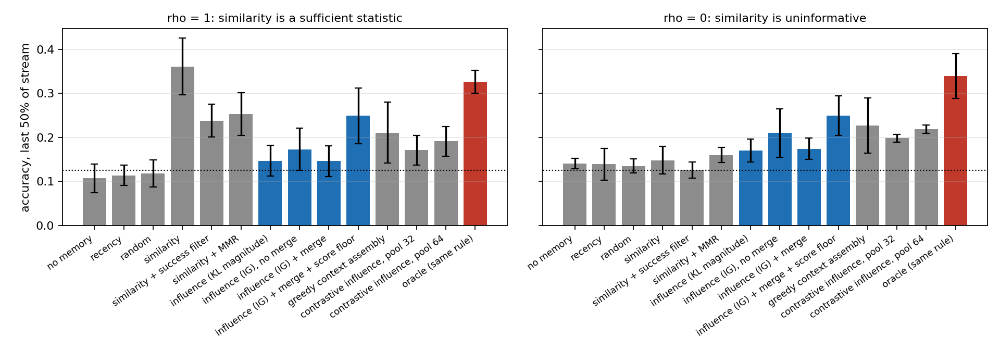
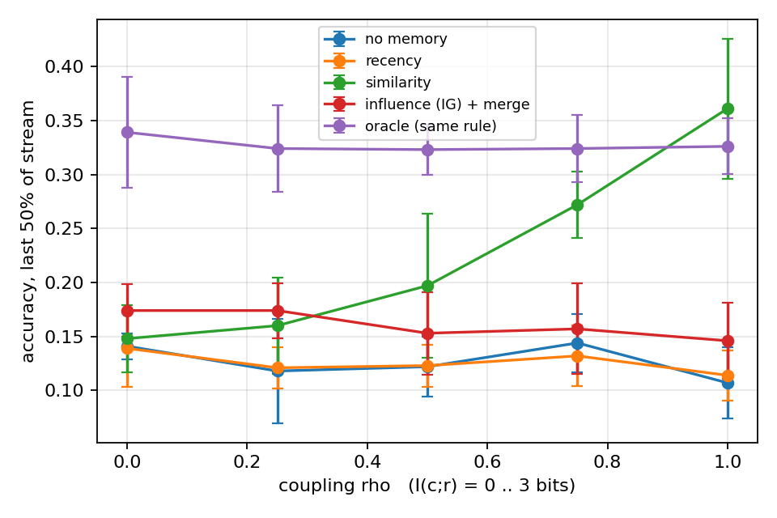
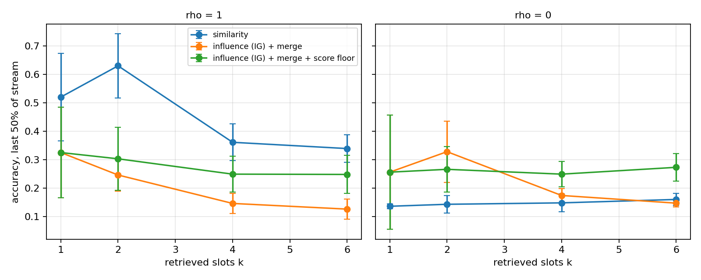

# Память, организованная вокруг будущих решений агента

Синтетическая последовательная среда, замороженный трансформер-ридер,
14 правил извлечения при одинаковом бюджете памяти, 5 сидов. Всё считалось на CPU.

## 1. Вопрос

Реализации памяти агента почти всегда ранжируют прошлый опыт по похожести
описаний. Это опирается на допущение, что семантическая похожесть — достаточная
статистика полезности. Допущение не обязано выполняться: признак, определяющий
правильное действие, может занимать малую долю текста и не доминировать в
эмбеддинге.

**При каких условиях отбор опыта по его влиянию на будущее решение полезнее
отбора по похожести описаний, и где преимущество исчезает.**

## 2. Гипотезы

**H1.** Полезность отбора по решениям определяется взаимной информацией между
поверхностной структурой ситуации и её решающим признаком. При высокой `I(c;r)`
оба подхода эквивалентны, при нулевой отбор по похожести вырождается.

**H2a.** Преимущество меняется монотонно по `I(c;r)`.

**H2b (собственная гипотеза).** Преимущество убывает с ростом числа извлекаемых
слотов `k`: при достаточно большом `k` даже неинформативное ранжирование
захватывает нужный опыт. Decision-aware память — способ экономить бюджет, а не
извлекать недоступную информацию.

**H3.** Величина сдвига политики — плохой критерий. Работать должен знаковый
критерий, измеряющий снижение неопределённости решения.

Результат по H2b оказался сильнее формулировки: преимущество не просто убывает,
а обращается в проигрыш, и по обеим осям — по связи и по бюджету.

## 3. Среда

```
project ledger_svc team fin_ops request settle journal for clearing in dc_north tag six
                   |----------------- поверхностный кластер c ----------------|  |прав. r|
```

* **Кластер `c`** задаёт словарь: одиннадцать из двенадцати содержательных
  токенов. Определяет геометрию эмбеддинга.
* **Правило `r`** выражено одним маркерным токеном и только оно определяет
  правильное действие.
* Отображение `правило → действие` — биекция, заново разыгрываемая для каждого
  экземпляра среды (тест `test_rule_action_map_varies_across_instances`).
  Запомнить её в весах нельзя.
* Обратная связь бинарная. Правильное действие не сообщается, поэтому единица
  опыта информативна и при неудаче — она исключает одно действие.

Параметр `rho` задаёт `P(c = r)`, а с ним `I(c;r)`: 3 бита при `rho=1`, 0 бит при
`rho=0`. Закрытая форма выведена в `dam/env.py` и сверена с эмпирической оценкой
в тесте `test_coupling_matches_closed_form` (расхождение < 0.05 бита).

Между режимами меняется ровно один параметр генератора. Агент, энкодер, бюджет,
длина потока и последовательность ситуаций при фиксированном сиде совпадают.

### 3.1. Калибровка среды

Первая версия использовала редкие псевдотокены-маркеры (`t7f`, `q2a`). Замер
показал, что энкодер считает такой маркер самой отличительной частью
предложения: среди четырёх ближайших соседей доля совпадающих маркеров — 0.844
при случайном уровне 0.125. В такой среде извлечение по похожести ранжирует
именно по маркеру, оба режима совпадают, и вопрос становится непроверяемым.

Маркеры заменены на частотные нейтральные токены (`one` … `eight`),
поверхностный словарь расширен до трёх вариантов на каждое из шести полей
(8 × 3⁶ × 8 = 46 656 возможных ситуаций). После калибровки
(`python -m scripts.probe_embeddings`, 8000 ситуаций):

| величина | значение | случайный уровень |
|---|---|---|
| линейный пробинг маркера по эмбеддингу | 0.979 | 0.125 |
| линейный пробинг кластера | 1.000 | 0.125 |
| доля соседей (k=4) с тем же маркером | 0.279 | 0.125 |
| доля соседей (k=4) с тем же кластером | **1.000** | 0.125 |

Решающий признак присутствует в эмбеддинге и линейно из него извлекается
(0.979), но косинусная близость ранжирует не по нему: среди ближайших соседей
кластер совпадает всегда, маркер — в 28% случаев. Это исключает альтернативное
прочтение «похожесть проигрывает, потому что энкодер не видит маркер».

## 4. Агент как измерительный прибор

**Ридер.** Декодер-only трансформер, 1.45 млн параметров (4 слоя, d=192,
4 головы), обучен с нуля. Множество действий закрыто, поэтому `π(a | s, M)` —
точное категориальное распределение, и величины уровня решений (KL, энтропия)
вычисляются точно, а не оцениваются сэмплированием.

**Обучение один раз, затем заморозка.** Контексты порождаются
retrieval-агностично: число релевантных воспоминаний, их исходы и кластеры
разыгрываются случайно, `rho` берётся из `U[0,1]`. Это разделяет два вопроса:
умеет ли агент пользоваться релевантным опытом в контексте, и помещает ли туда
релевантный опыт конкретное правило. Изучается только второе.

**Измеренные свойства ридера** (`scripts/probe_reader.py`, 800 контекстов):

| контекст (k=4) | точность |
|---|---|
| есть воспоминание с тем же правилом и успешным исходом | 0.795 |
| есть с тем же правилом, исход неуспешный | 0.136 |
| нет воспоминаний с тем же правилом | 0.073 |

Точность ниже случайного уровня 0.125 в двух последних строках закономерна:
воспоминание, помеченное как неудача, исключает своё действие.

**Ограничение ридера, определившее весь дальнейший разбор.** Точность при одном
релевантном успешном воспоминании и `n` посторонних **успешных**:

| посторонних успехов | 0 | 1 | 2 | 3 |
|---|---|---|---|---|
| точность | **1.000** | 0.530 | 0.382 | 0.300 |
| случайный выбор среди успехов | 1.000 | 0.500 | 0.333 | 0.250 |

Ридер выбирает среди успешных записей почти равномерно. Три попытки исправить
это со стороны обучающего распределения (доля разрешимых контекстов 0.55 → 0.70,
принудительная доля успешных дистракторов, удаление служебных разделителей)
не сдвинули цифру выше 0.33. При этом контекст с одним релевантным воспоминанием
и посторонними **неуспешными** решается идеально:

| размер контекста | 1 | 2 | 4 | 6 |
|---|---|---|---|---|
| точность | 1.000 | 1.000 | 1.000 | 0.862 |

Значит проблема не в длине контекста и не в способности читать маркер, а именно
в арбитраже между несколькими уверенными записями.

**Калибровка при одном воспоминании** — то, из чего собран решенческий скор:

| одиночное воспоминание | информационный выигрыш |
|---|---|
| тот же маркер, успех | **1.611** |
| посторонний маркер, успех | 0.683 |
| тот же маркер, неудача | −0.000 |
| посторонний маркер, неудача | −0.000 |

Вероятность того, что релевантный успех обгонит посторонний, — 0.845.

## 5. Правила извлечения

Все получают одно хранилище, одну вместимость (128), одно число слотов и один
поток ситуаций. Вытеснение FIFO, одинаковое для всех.

| семейство | правило | критерий |
|---|---|---|
| пол | `none` | — |
| описание | `recency`, `random` | время, случай |
| описание | `similarity` | косинус эмбеддингов MiniLM, основной бейзлайн |
| контроль | `similarity_success` | то же, с приоритетом успешных исходов |
| контроль | `mmr` | то же, с диверсификацией |
| решение | `influence_kl` | `D_KL(π(·\|s,m) ‖ π(·\|s))`, модуль сдвига |
| решение | `influence_ig_nodedup` | `H(π(·\|s)) − H(π(·\|s,m))`, без слияния |
| решение | `influence_ig` | то же + слияние по эквивалентности решений |
| решение | `influence_ig_floor` | то же + порог: кандидат ниже половины лучшего отбрасывается |
| решение | `greedy_32` | жадная сборка: минимизация энтропии собранного контекста |
| решение | `contrastive_P_C` | `IG(s,m) − mean_j IG(s_j,m)` по контрольным ситуациям |
| потолок | `oracle` | истинное латентное правило |

`similarity_success` и `mmr` закрывают два очевидных прочтения: что выигрыш даёт
сам факт обусловливания на успешные исходы и что его даёт разнообразие контекста.

**Слияние по эквивалентности решений.** Логарифмический сдвиг
`log π(·|s,m) − log π(·|s)` уже вычислен для каждого кандидата, поэтому кандидат
с почти коллинеарным сдвигом пропускается: два воспоминания, различные как
тексты, но эквивалентные как решения, избыточны при фиксированном бюджете.

## 6. Результаты

Все интервалы — 95% по Стьюденту по 5 сидам. Сравнения с `similarity` парные по
сиду: поток ситуаций и сэмплирование действий общие внутри сида.

`sufficient@k` — доля шагов, на которых извлечённый набор содержит воспоминание
с тем же правилом и успешным исходом, то есть достаточное для решения.

### 6.1. Главное сравнение, k = 4

| правило | acc, ρ=1 | suf, ρ=1 | acc, ρ=0 | suf, ρ=0 | Δacc vs similarity, ρ=0 |
|---|---|---|---|---|---|
| без памяти | 0.107 ± 0.033 | 0.000 | 0.141 ± 0.012 | 0.000 | −0.007 (p=0.66) |
| недавность | 0.114 ± 0.023 | 0.046 | 0.139 ± 0.036 | 0.051 | −0.009 (p=0.48) |
| случайно | 0.118 ± 0.031 | 0.057 | 0.135 ± 0.016 | 0.052 | −0.013 (p=0.38) |
| **похожесть** | **0.361 ± 0.065** | 0.774 | 0.148 ± 0.031 | **0.070** | — |
| похожесть + фильтр успеха | 0.238 ± 0.037 | 0.830 | 0.126 ± 0.018 | 0.401 | −0.022 (p=0.12) |
| похожесть + MMR | 0.253 ± 0.049 | 0.514 | 0.160 ± 0.017 | 0.130 | +0.012 (p=0.24) |
| влияние, модуль KL | 0.147 ± 0.035 | 0.806 | 0.170 ± 0.026 | **0.869** | +0.022 (p=0.13) |
| влияние IG, без слияния | 0.173 ± 0.048 | 0.501 | 0.210 ± 0.055 | 0.592 | +0.062 (p=0.10) |
| влияние IG + слияние | 0.146 ± 0.035 | 0.823 | 0.174 ± 0.024 | **0.861** | +0.026 (p=0.24) |
| **влияние IG + слияние + порог** | 0.249 ± 0.063 | 0.777 | **0.249 ± 0.045** | 0.672 | **+0.101 (p=0.013)** |
| жадная сборка контекста | 0.211 ± 0.069 | 0.388 | 0.227 ± 0.063 | 0.386 | +0.079 (p=0.054) |
| контрастный скор, пул 32 | 0.171 ± 0.034 | 0.456 | 0.198 ± 0.009 | 0.496 | +0.050 (p=0.009) |
| контрастный скор, пул 64 | 0.191 ± 0.033 | 0.620 | 0.219 ± 0.009 | 0.734 | +0.071 (p=0.001) |
| oracle | 0.326 ± 0.026 | 0.994 | 0.339 ± 0.051 | 0.984 | +0.191 (p=0.001) |



**Извлечение.** При ρ=0 похожесть находит достаточный опыт в 7.0% случаев —
ниже случайного отбора не отличимо. Решенческие критерии находят его в
86.1–86.9%, то есть **на уровне oracle** (98.4%) с точностью до эффектов
вытеснения. Разрыв — фактор 12. Это прямое подтверждение H1 на оси извлечения.

**Решения.** Полнота не переходит в точность автоматически. При suf = 0.861
точность 0.174, при oracle suf = 0.984 — 0.339. Причина измерена в разделе 4:
остальные три слота заполняются посторонними успешными записями, среди которых
ридер выбирает почти равномерно. Правило с порогом, оставляющее слоты пустыми,
даёт лучший неоракульный результат: **0.249 ± 0.045 против 0.148 ± 0.031**
у похожести, парная разность +0.101 (p = 0.013), при **меньшей** полноте (0.672
против 0.861). Набор побеждает не полнотой, а чистотой.

**Инверсия при ρ=1.** Похожесть даёт 0.361 и превосходит все решенческие правила
и сам oracle (0.326). Преимущество decision-aware памяти не просто исчезает при
высокой связи — оно меняет знак.

### 6.2. Развёртка по связи (H1, H2a)

| правило | ρ=0 (0 бит) | ρ=0.25 | ρ=0.5 | ρ=0.75 | ρ=1 (3 бита) |
|---|---|---|---|---|---|
| без памяти | 0.141 | 0.118 | 0.122 | 0.144 | 0.107 |
| недавность | 0.139 | 0.121 | 0.123 | 0.132 | 0.114 |
| похожесть | 0.148 | 0.160 | 0.197 | 0.272 | **0.361** |
| влияние IG + слияние | 0.174 | 0.174 | 0.153 | 0.157 | 0.146 |
| oracle | 0.339 | 0.324 | 0.323 | 0.324 | 0.326 |



Похожесть монотонно растёт с `I(c;r)`: 0.148 → 0.361. Решенческий критерий и
oracle плоские: они не пользуются связью, поскольку не смотрят на описание.
Точка пересечения лежит между ρ=0.25 и ρ=0.5, то есть преимущество
decision-aware памяти исчезает уже при **менее чем 1 бите** взаимной информации,
задолго до максимума. H2a подтверждена в количественной форме.

### 6.3. Развёртка по бюджету при ρ=0 (H2b)

| правило | k=1 | k=2 | k=4 | k=6 |
|---|---|---|---|---|
| похожесть | 0.136 ± 0.008 | 0.143 ± 0.031 | 0.148 ± 0.031 | 0.160 ± 0.022 |
| влияние IG + слияние | 0.256 ± 0.201 | **0.328 ± 0.108** | 0.174 ± 0.024 | 0.147 ± 0.013 |
| влияние IG + слияние + порог | 0.256 ± 0.201 | 0.266 ± 0.079 | 0.249 ± 0.045 | **0.273 ± 0.048** |



Три разные зависимости от бюджета, и вместе они образуют главный результат по
собственной гипотезе.

Похожесть слабо растёт с `k`: больше слотов — выше шанс случайно захватить
нужное. Решенческий критерий без порога немонотонен: максимум при `k=2` (0.328),
деградация вдвое к `k=6` (0.147). Каждый дополнительный слот заполняется
кандидатом с высоким скором, но посторонним, и вредит больше, чем помогает.

Тот же критерий с порогом плоский: 0.249–0.273 на всём диапазоне, при `k=1`
совпадает с беспороговым тривиально (один слот). **Порог убирает зависимость от
бюджета.** Это прямая проверка объяснения: если деградация вызвана добором
слотов, то запрет на добор должен её устранить — он и устраняет.

Отсюда практический вывод, ради которого стоило ставить эксперимент:
**бюджет `k` — верхняя граница, а не квота.** Причём для описательных критериев
это неверно: у похожести нет шкалы, на которой можно поставить порог, — косинус
0.6 сам по себе ничего не означает. У решенческого критерия шкала есть: он
измеряется в натах снятой неопределённости решения, и «вдвое хуже лучшего
кандидата» — осмысленное утверждение. Возможность не выбрать ничего — отдельное
преимущество решенческой формулировки, не сводящееся к качеству ранжирования.

### 6.4. Ошибочные варианты

Три предложенных механизма измерены и проиграли простому порогу. Приводятся с
причинами, а не убираются.

| вариант | acc при ρ=0 | почему не сработал |
|---|---|---|
| жадная сборка контекста | 0.227 ± 0.063 | минимизирует энтропию набора; четыре уверенных записи дают низкую энтропию и неверный ответ — энтропия не тот функционал для сборки |
| контрастный скор, пул 64 | 0.219 ± 0.009 | вычитает общий эффект флага `<ok>`; отношение сигнал/шум не выросло достаточно, зато пул сузился |
| модуль сдвига KL | 0.170 ± 0.026 | отбирает записи, сильно меняющие решение, а не меняющие его верно; полнота 0.869 при точности на уровне случая — подтверждение H3 |

## 7. Альтернативные объяснения и их проверка

| прочтение | чем закрыто |
|---|---|
| энкодер не видит маркер | линейный пробинг маркера 0.979 (раздел 3.1) |
| выигрыш даёт обусловливание на успешные исходы | `similarity_success`: suf 0.401 при ρ=0, acc 0.126 — ниже похожести |
| выигрыш даёт разнообразие контекста | `mmr`: acc 0.160, Δ = +0.012, p = 0.24 |
| выигрыш даёт «любой контекст в промпте» | `random`: 0.135, `none`: 0.141 — неотличимы |
| выигрыш даёт большая вычислительная стоимость | `influence_kl` тратит столько же прямых проходов, что и `influence_ig`, и даёт 0.170 против 0.249 у варианта с порогом |
| различия — случайность | 5 сидов, парные сравнения по сиду, доверительные интервалы; общий поток ситуаций и общее сэмплирование действий внутри сида |

## 8. Границы применимости

**Главная граница, установленная измерением.** Решенческий скор строится из той
же политики, которой служит, и наследует её слепые пятна. На реальном хранилище
информационный выигрыш **всех** успешных записей лежит в диапазоне 1.50–1.68
независимо от совпадения маркера, хотя на синтетических парах среднее разделение
1.611 против 0.683. Когда на один релевантный успех приходится тридцать
посторонних, среднего разделения в 2.4 раза не хватает: максимум по тридцати
шумным значениям регулярно перебивает одно сигнальное. Отсюда общее утверждение:
**decision-aware память ограничена сверху способностью самого агента различать
релевантность на уровне решений.** Она не создаёт различение, а эксплуатирует
уже имеющееся.

Прочие границы:

* Один ридер, обученный один раз. Разброс по сидам обучения ридера не
  измерялся — все 5 сидов относятся к среде и потоку, но не к весам.
* Порог зафиксирован как относительный (половина лучшего скора) и не
  оптимизировался; его развёртка не проводилась.
* Хранилище 128 записей, поток 400 шагов. При большем хранилище отношение
  «один релевантный к N посторонним» ухудшается, и предсказание модели —
  дальнейшее падение решенческих правил. Не проверено.
* Среда синтетическая по построению. Утверждение переносится на реальные
  постановки ровно в той мере, в какой в них тоже есть низкомассовый решающий
  признак при доминирующем поверхностном контексте.

## 9. Следующий эксперимент

Из раздела 8 следует конкретная проверка. Если ограничение — различающая
способность агента, а не критерий, то улучшение агента должно поднимать
решенческие правила и не трогать похожесть. Эксперимент: обучить два ридера,
различающихся только точностью арбитража между успешными записями (её можно
двигать долей соответствующих контекстов в обучении), и снять всю таблицу 6.1
на обоих. Предсказание: `similarity` при ρ=0 не сдвинется (она и так не находит
нужного), `influence_*` вырастут пропорционально арбитражу, а точка пересечения
на развёртке по связи (6.2) сместится вправо.

Это отделяет утверждение «критерий плох» от «критерий упирается в агента» —
единственное, что в текущей работе разделено только косвенно.

## Воспроизведение

CPU, GPU не использовался.

```bash
pip install -r requirements.txt
pytest -q
python -m dam.train --steps 5000 --seed 0
python -m scripts.probe_embeddings
python -m scripts.probe_reader
python -m scripts.probe_selection --rho 0.0
python -m scripts.run_experiments --seeds 5 --steps 400 --capacity 128
python -m scripts.analyze
```

`results/runs.jsonl` — сырые числа по всем прогонам, `results/tables.md` и
`results/figures/` — сводные таблицы и графики.
