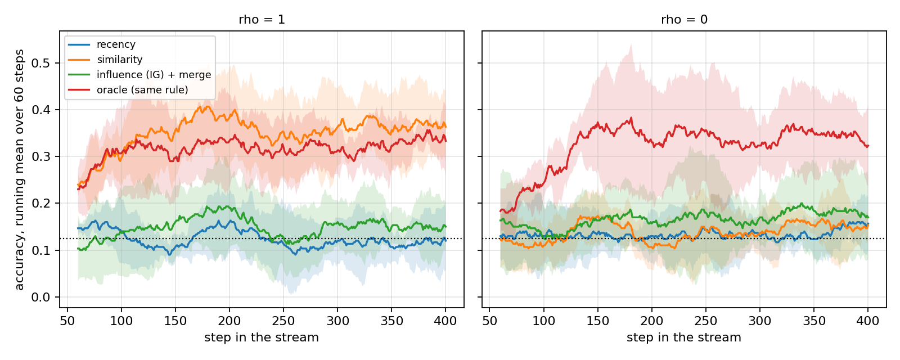

# Память, организованная вокруг будущих решений агента

Синтетическая последовательная среда, замороженный трансформер-ридер,
14 правил извлечения при одинаковом бюджете памяти, 5 сидов среды и 3 сида
обучения ридера, 405 прогонов. Всё считалось на CPU.

**Краткий итог.** На оси извлечения эффект большой и устойчивый: при нулевой
связи решенческий отбор находит достаточный опыт в 66–75% случаев против 6.7% у
косинусной похожести, на всех трёх ридерах. На оси решений выигрыш **не
установлен**: на одном ридере он есть (+0.101, p = 0.013), на трёх разброс по
ридерам (±0.271) превышает эффект, и на одном из них метод падает ниже
похожести. Дисперсия измерительного прибора оказалась больше изучаемого эффекта
— это и есть главный результат работы.

## 1. Вопрос

Реализации памяти агента почти всегда ранжируют прошлый опыт по похожести
описаний. Это опирается на допущение, что семантическая похожесть — достаточная
статистика полезности. Допущение не обязано выполняться: признак, определяющий
правильное действие, может занимать малую долю текста и не доминировать в
эмбеддинге.

**При каких условиях отбор опыта по его влиянию на будущее решение полезнее
отбора по похожести описаний, и где преимущество исчезает.**

## 2. Гипотезы

**H1.** Полезность отбора по решениям определяется взаимной информацией между
поверхностной структурой ситуации и её решающим признаком. При высокой `I(c;r)`
оба подхода эквивалентны, при нулевой отбор по похожести вырождается.

**H2a.** Преимущество меняется монотонно по `I(c;r)`.

**H2b (собственная гипотеза).** Преимущество убывает с ростом числа извлекаемых
слотов `k`: при достаточно большом `k` даже неинформативное ранжирование
захватывает нужный опыт. Decision-aware память — способ экономить бюджет, а не
извлекать недоступную информацию.

**H3.** Величина сдвига политики — плохой критерий. Работать должен знаковый
критерий, измеряющий снижение неопределённости решения.

Результат по H2b оказался сильнее формулировки: преимущество не просто убывает,
а обращается в проигрыш, и по обеим осям — по связи и по бюджету.

## 3. Среда

```
project ledger_svc team fin_ops request settle journal for clearing in dc_north tag six
                   |----------------- поверхностный кластер c ----------------|  |прав. r|
```

* **Кластер `c`** задаёт словарь: одиннадцать из двенадцати содержательных
  токенов. Определяет геометрию эмбеддинга.
* **Правило `r`** выражено одним маркерным токеном и только оно определяет
  правильное действие.
* Отображение `правило → действие` — биекция, заново разыгрываемая для каждого
  экземпляра среды (тест `test_rule_action_map_varies_across_instances`).
  Запомнить её в весах нельзя.
* Обратная связь бинарная. Правильное действие не сообщается, поэтому единица
  опыта информативна и при неудаче — она исключает одно действие.

Параметр `rho` задаёт `P(c = r)`, а с ним `I(c;r)`: 3 бита при `rho=1`, 0 бит при
`rho=0`. Закрытая форма выведена в `dam/env.py` и сверена с эмпирической оценкой
в тесте `test_coupling_matches_closed_form` (расхождение < 0.05 бита).

Между режимами меняется ровно один параметр генератора. Агент, энкодер, бюджет,
длина потока и последовательность ситуаций при фиксированном сиде совпадают.

### 3.1. Калибровка среды

Первая версия использовала редкие псевдотокены-маркеры (`t7f`, `q2a`). Замер
показал, что энкодер считает такой маркер самой отличительной частью
предложения: среди четырёх ближайших соседей доля совпадающих маркеров — 0.844
при случайном уровне 0.125. В такой среде извлечение по похожести ранжирует
именно по маркеру, оба режима совпадают, и вопрос становится непроверяемым.

Маркеры заменены на частотные нейтральные токены (`one` … `eight`),
поверхностный словарь расширен до трёх вариантов на каждое из шести полей
(8 × 3⁶ × 8 = 46 656 возможных ситуаций). После калибровки
(`python -m scripts.probe_embeddings`, 8000 ситуаций):

| величина | значение | случайный уровень |
|---|---|---|
| линейный пробинг маркера по эмбеддингу | 0.979 | 0.125 |
| линейный пробинг кластера | 1.000 | 0.125 |
| доля соседей (k=4) с тем же маркером | 0.279 | 0.125 |
| доля соседей (k=4) с тем же кластером | **1.000** | 0.125 |

Решающий признак присутствует в эмбеддинге и линейно из него извлекается
(0.979), но косинусная близость ранжирует не по нему: среди ближайших соседей
кластер совпадает всегда, маркер — в 28% случаев. Это исключает альтернативное
прочтение «похожесть проигрывает, потому что энкодер не видит маркер».

## 4. Агент как измерительный прибор

**Ридер.** Декодер-only трансформер, 1.45 млн параметров (4 слоя, d=192,
4 головы), обучен с нуля. Множество действий закрыто, поэтому `π(a | s, M)` —
точное категориальное распределение, и величины уровня решений (KL, энтропия)
вычисляются точно, а не оцениваются сэмплированием.

**Обучение один раз, затем заморозка.** Контексты порождаются
retrieval-агностично: число релевантных воспоминаний, их исходы и кластеры
разыгрываются случайно, `rho` берётся из `U[0,1]`. Это разделяет два вопроса:
умеет ли агент пользоваться релевантным опытом в контексте, и помещает ли туда
релевантный опыт конкретное правило. Изучается только второе.

**Измеренные свойства ридера** (`scripts/probe_reader.py`, 800 контекстов):

| контекст (k=4) | точность |
|---|---|
| есть воспоминание с тем же правилом и успешным исходом | 0.795 |
| есть с тем же правилом, исход неуспешный | 0.136 |
| нет воспоминаний с тем же правилом | 0.073 |

Точность ниже случайного уровня 0.125 в двух последних строках закономерна:
воспоминание, помеченное как неудача, исключает своё действие.

**Ограничение ридера, определившее весь дальнейший разбор.** Точность при одном
релевантном успешном воспоминании и `n` посторонних **успешных**:

| посторонних успехов | 0 | 1 | 2 | 3 |
|---|---|---|---|---|
| точность | **1.000** | 0.530 | 0.382 | 0.300 |
| случайный выбор среди успехов | 1.000 | 0.500 | 0.333 | 0.250 |

Ридер выбирает среди успешных записей почти равномерно. Три попытки исправить
это со стороны обучающего распределения (доля разрешимых контекстов 0.55 → 0.70,
принудительная доля успешных дистракторов, удаление служебных разделителей)
не сдвинули цифру выше 0.33. При этом контекст с одним релевантным воспоминанием
и посторонними **неуспешными** решается идеально:

| размер контекста | 1 | 2 | 4 | 6 |
|---|---|---|---|---|
| точность | 1.000 | 1.000 | 1.000 | 0.862 |

Значит проблема не в длине контекста и не в способности читать маркер, а именно
в арбитраже между несколькими уверенными записями.

**Калибровка при одном воспоминании** — то, из чего собран решенческий скор:

| одиночное воспоминание | информационный выигрыш |
|---|---|
| тот же маркер, успех | **1.611** |
| посторонний маркер, успех | 0.683 |
| тот же маркер, неудача | −0.000 |
| посторонний маркер, неудача | −0.000 |

Вероятность того, что релевантный успех обгонит посторонний, — 0.845.

## 5. Правила извлечения

Все получают одно хранилище, одну вместимость (128), одно число слотов и один
поток ситуаций. Вытеснение FIFO, одинаковое для всех.

| семейство | правило | критерий |
|---|---|---|
| пол | `none` | — |
| описание | `recency`, `random` | время, случай |
| описание | `similarity` | косинус эмбеддингов MiniLM, основной бейзлайн |
| контроль | `similarity_success` | то же, с приоритетом успешных исходов |
| контроль | `mmr` | то же, с диверсификацией |
| решение | `influence_kl` | `D_KL(π(·\|s,m) ‖ π(·\|s))`, модуль сдвига |
| решение | `influence_ig_nodedup` | `H(π(·\|s)) − H(π(·\|s,m))`, без слияния |
| решение | `influence_ig` | то же + слияние по эквивалентности решений |
| решение | `influence_ig_floor` | то же + порог: кандидат ниже половины лучшего отбрасывается |
| решение | `greedy_32` | жадная сборка: минимизация энтропии собранного контекста |
| решение | `contrastive_P_C` | `IG(s,m) − mean_j IG(s_j,m)` по контрольным ситуациям |
| потолок | `oracle` | истинное латентное правило |

`similarity_success` и `mmr` закрывают два очевидных прочтения: что выигрыш даёт
сам факт обусловливания на успешные исходы и что его даёт разнообразие контекста.

**Слияние по эквивалентности решений.** Логарифмический сдвиг
`log π(·|s,m) − log π(·|s)` уже вычислен для каждого кандидата, поэтому кандидат
с почти коллинеарным сдвигом пропускается: два воспоминания, различные как
тексты, но эквивалентные как решения, избыточны при фиксированном бюджете.

## 6. Результаты

Все интервалы — 95% по Стьюденту по 5 сидам среды. Сравнения парные по сиду:
поток ситуаций и сэмплирование действий общие внутри сида.

`sufficient@k` — доля шагов, на которых извлечённый набор содержит воспоминание
с тем же правилом и успешным исходом, то есть достаточное для решения.

**Область репликации.** Ридер обучен трижды (сиды 0, 1, 2). На всех трёх снята
таблица 6.1 для пяти правил: `none`, `similarity`, `influence_ig`,
`influence_ig_floor`, `oracle`. Остальные девять правил, развёртки по связи и по
бюджету и диагностика на замороженном хранилище сняты на одном ридере (сид 0).
Это различие существенно — см. 6.2.

### 6.1. Главное сравнение, k = 4, ридер сида 0

| правило | acc, ρ=1 | suf, ρ=1 | acc, ρ=0 | suf, ρ=0 | Δacc vs similarity, ρ=0 |
|---|---|---|---|---|---|
| без памяти | 0.107 ± 0.033 | 0.000 | 0.141 ± 0.012 | 0.000 | −0.007 (p=0.66) |
| недавность | 0.114 ± 0.023 | 0.046 | 0.139 ± 0.036 | 0.051 | −0.009 (p=0.48) |
| случайно | 0.118 ± 0.031 | 0.057 | 0.135 ± 0.016 | 0.052 | −0.013 (p=0.38) |
| **похожесть** | **0.361 ± 0.065** | 0.774 | 0.148 ± 0.031 | **0.070** | — |
| похожесть + фильтр успеха | 0.238 ± 0.037 | 0.830 | 0.126 ± 0.018 | 0.401 | −0.022 (p=0.12) |
| похожесть + MMR | 0.253 ± 0.049 | 0.514 | 0.160 ± 0.017 | 0.130 | +0.012 (p=0.24) |
| влияние, модуль KL | 0.147 ± 0.035 | 0.806 | 0.170 ± 0.026 | **0.869** | +0.022 (p=0.13) |
| влияние IG, без слияния | 0.173 ± 0.048 | 0.501 | 0.210 ± 0.055 | 0.592 | +0.062 (p=0.10) |
| влияние IG + слияние | 0.146 ± 0.035 | 0.823 | 0.174 ± 0.024 | **0.861** | +0.026 (p=0.24) |
| влияние IG + слияние + порог | 0.249 ± 0.063 | 0.777 | 0.249 ± 0.045 | 0.672 | +0.101 (p=0.013) |
| жадная сборка контекста | 0.211 ± 0.069 | 0.388 | 0.227 ± 0.063 | 0.386 | +0.079 (p=0.054) |
| контрастный скор, пул 32 | 0.171 ± 0.034 | 0.456 | 0.198 ± 0.009 | 0.496 | +0.050 (p=0.009) |
| контрастный скор, пул 64 | 0.191 ± 0.033 | 0.620 | 0.219 ± 0.009 | 0.734 | +0.071 (p=0.001) |
| oracle | 0.326 ± 0.026 | 0.994 | 0.339 ± 0.051 | 0.984 | +0.191 (p=0.001) |


**Извлечение.** При ρ=0 похожесть находит достаточный опыт в 7.0% случаев —
неотличимо от случайного отбора. Решенческие критерии находят его в 86.1–86.9%,
то есть на уровне oracle (98.4%). Разрыв — фактор 12.

**Решения.** Полнота не переходит в точность автоматически. При suf = 0.861
точность 0.174, при oracle suf = 0.984 — 0.339. На этом ридере лучший
неоракульный результат даёт правило с порогом: 0.249 против 0.148 у похожести,
парная разность +0.101 (p = 0.013), причём при **меньшей** полноте.

### 6.2. Повторение на трёх независимо обученных ридерах

Ридер обучался один раз, и вся работа опиралась на этот один набор весов.
Повторение на двух дополнительных сидах меняет выводы.

| правило | ρ | ридер 0 | ридер 1 | ридер 2 | среднее ± полуразмах |
|---|---|---|---|---|---|
| без памяти | 0 | 0.141 | 0.143 | 0.134 | 0.139 ± 0.005 |
| похожесть | 0 | 0.148 | 0.145 | 0.138 | **0.144 ± 0.005** |
| влияние IG + слияние | 0 | 0.174 | 0.202 | 0.132 | 0.169 ± 0.035 |
| влияние IG + слияние + порог | 0 | 0.249 | 0.676 | **0.135** | 0.353 ± **0.271** |
| oracle | 0 | 0.339 | 0.675 | 0.530 | 0.515 ± 0.168 |
| похожесть | 1 | 0.361 | 0.562 | 0.418 | 0.447 ± 0.100 |
| влияние IG + слияние + порог | 1 | 0.249 | 0.621 | 0.117 | 0.329 ± 0.252 |
| oracle | 1 | 0.326 | 0.651 | 0.478 | 0.485 ± 0.163 |

**Заявление о точности не воспроизводится.** Правило с порогом даёт 0.249,
0.676 и 0.135 на трёх ридерах. На третьем оно оказывается **ниже** похожести
(0.135 против 0.138). Разброс по ридерам (±0.271) на порядок превышает эффект,
измеренный на одном (+0.101). Значение p = 0.013 из 6.1 корректно как парный
тест по сидам среды и бесполезно как утверждение о методе: ридер входил в
эксперимент как фиксированная величина, хотя является источником дисперсии,
доминирующим над всеми остальными.

**Что воспроизводится.** Похожесть при ρ=0 стабильна: 0.148 / 0.145 / 0.138,
полуразмах 0.005. Полнота решенческих критериев тоже устойчива: 0.663–0.749
против 0.067 у похожести на всех ридерах. Расходится именно **переход от
полноты к решению**, и его величина — свойство ридера, а не правила извлечения.

**Чем различаются ридеры.** Все статические пробы совпадают: argmax на
oracle-контексте 1.000 у всех трёх, арбитраж между успешными записями 0.296 и
0.298, энтропия без памяти 2.07–2.08 при равномерной 2.079. Различие
обнаруживается только в массе вероятности и только на одном типе контекста:

| ридер | P(верное) при записях о неудачах **того же правила** | при неудачах посторонних правил |
|---|---|---|
| 0 | 0.492 | 0.491 |
| 1 | **0.698** | 0.498 |
| 2 | 0.508 | 0.508 |

Ридер 1 научился вычёркивать действия по записям о неудачах того же правила;
ридеры 0 и 2 — нет. Онлайн-метрика сэмплирует действие из политики, поэтому
результат определяет масса вероятности, а не argmax. Это объясняет, почему
выделяется ридер 1, но **не** объясняет разрыв между ридерами 0 и 2 (oracle
0.339 против 0.530 при одинаковых 0.492 и 0.508 в пробе). Остаточная дисперсия
остаётся неатрибутированной.

### 6.3. Развёртка по связи, ридер сида 0 (H1, H2a)

| правило | ρ=0 (0 бит) | ρ=0.25 | ρ=0.5 | ρ=0.75 | ρ=1 (3 бита) |
|---|---|---|---|---|---|
| без памяти | 0.141 | 0.118 | 0.122 | 0.144 | 0.107 |
| недавность | 0.139 | 0.121 | 0.123 | 0.132 | 0.114 |
| похожесть | 0.148 | 0.160 | 0.197 | 0.272 | **0.361** |
| влияние IG + слияние | 0.174 | 0.174 | 0.153 | 0.157 | 0.146 |
| oracle | 0.339 | 0.324 | 0.323 | 0.324 | 0.326 |


Похожесть монотонно растёт с `I(c;r)`: 0.148 → 0.361. Решенческий критерий и
oracle плоские — они не пользуются связью, поскольку не смотрят на описание.
Монотонность по связи (H2a) устойчива по построению: она следует из того, что
похожесть ранжирует по кластеру, а `rho` управляет информативностью кластера.

Точка пересечения на этом ридере лежит между ρ=0.25 и ρ=0.5. Но на ридере 1
похожесть при ρ=1 даёт 0.562, а правило с порогом 0.621, то есть пересечения нет
вовсе. Положение точки пересечения — свойство пары «ридер, правило», а не среды.

### 6.4. Развёртка по бюджету при ρ=0, ридер сида 0 (H2b)

| правило | k=1 | k=2 | k=4 | k=6 |
|---|---|---|---|---|
| похожесть | 0.136 ± 0.008 | 0.143 ± 0.031 | 0.148 ± 0.031 | 0.160 ± 0.022 |
| влияние IG + слияние | 0.256 ± 0.201 | **0.328 ± 0.108** | 0.174 ± 0.024 | 0.147 ± 0.013 |
| влияние IG + слияние + порог | 0.256 ± 0.201 | 0.266 ± 0.079 | 0.249 ± 0.045 | **0.273 ± 0.048** |


Накопление опыта по ходу потока (скользящее среднее по 60 шагам, полоса — 95%
по сидам среды):



Похожесть слабо растёт с `k`. Решенческий критерий без порога немонотонен:
максимум при `k=2` (0.328), деградация вдвое к `k=6` (0.147). Тот же критерий с
порогом плоский: 0.249–0.273 на всём диапазоне.

Механизм согласован: если деградация вызвана добором слотов посторонними
уверенными записями, то запрет на добор должен её устранить — и устраняет. Но
поскольку 6.2 показала сильную зависимость абсолютных значений от ридера, статус
этого результата — **наблюдение на одном ридере**, а не установленное свойство
метода. Проверка на трёх ридерах не проводилась.

Отдельно стоит различие, от ридера не зависящее: у описательного критерия нет
шкалы, на которой можно поставить порог, — косинус 0.6 сам по себе ничего не
означает. У решенческого шкала есть, он измеряется в натах снятой
неопределённости. Возможность не заполнять слот доступна одному семейству
критериев и недоступна другому независимо от того, выигрывает ли она.

### 6.5. Отбор без обратной связи

В онлайн-протоколе правило формирует хранилище, из которого само же потом
читает. Диагностика `scripts/probe_selection.py` разделяет качество отбора и эту
петлю: хранилище строится один раз случайной политикой (128 записей, из них 11
успешных) и замораживается, все правила отвечают на одни и те же 200 запросов.
Ридер сида 0.

| правило | acc (заморож.) | suf (заморож.) | acc (онлайн) |
|---|---|---|---|
| похожесть | 0.115 | 0.025 | 0.148 |
| влияние IG + слияние | **0.415** | 0.845 | 0.174 |
| влияние IG + слияние + порог | 0.170 | 0.845 | **0.249** |
| oracle | 0.865 | 0.865 | 0.339 |

Ранг порога инвертируется между протоколами. Случайная политика оставляет 11
успешных записей на 128, верхний кандидат часто посторонний, и порог обрезает
контекст до него одного. В онлайне хранилище строит сам агент, и порог работает
внутри петли «чище контекст → вернее действие → больше успешных записей».

Методическое следствие: измерять правило извлечения на фиксированном корпусе
недостаточно, если в реальной постановке агент сам порождает свою память. Два
протокола дают противоположный ответ на один и тот же вопрос.

### 6.6. Ошибочные варианты

Три предложенных механизма измерены и проиграли простому порогу на ридере сида 0.

| вариант | acc при ρ=0 | почему не сработал |
|---|---|---|
| жадная сборка контекста | 0.227 ± 0.063 | минимизирует энтропию набора; четыре уверенных записи дают низкую энтропию и неверный ответ — энтропия не тот функционал для сборки |
| контрастный скор, пул 64 | 0.219 ± 0.009 | вычитает общий эффект флага `<ok>`; отношение сигнал/шум не выросло достаточно, зато пул сузился |
| модуль сдвига KL | 0.170 ± 0.026 | отбирает записи, сильно меняющие решение, а не меняющие его верно; полнота 0.869 при точности на уровне случая — подтверждение H3 |

С учётом 6.2 эти сравнения следует читать как упорядочивание на одном ридере,
без утверждения о переносимости.

## 7. Альтернативные объяснения и их проверка

| прочтение | чем закрыто |
|---|---|
| энкодер не видит маркер | линейный пробинг маркера 0.979 (раздел 3.1) |
| выигрыш даёт обусловливание на успешные исходы | `similarity_success`: suf 0.401 при ρ=0, acc 0.126 — ниже похожести |
| выигрыш даёт разнообразие контекста | `mmr`: acc 0.160, Δ = +0.012, p = 0.24 |
| выигрыш даёт «любой контекст в промпте» | `random`: 0.135, `none`: 0.141 — неотличимы |
| выигрыш даёт большая вычислительная стоимость | `influence_kl` тратит столько же прямых проходов, что и `influence_ig`, и даёт 0.170 |
| различия — случайность по среде | 5 сидов среды, парные сравнения, доверительные интервалы |
| различия — случайность по модели | **не закрыто для точности**: 3 сида ридера дают разброс, превышающий эффект (6.2) |

Последняя строка — измеренный результат, а не пробел в оформлении. Она меняет
статус пункта 6.1.

## 8. Выводы

**Устойчиво.** Отбор по влиянию на решение находит релевантный опыт там, где
похожесть его не находит: при нулевой связи 66–75% против 6.7%, на всех трёх
ридерах, при одинаковом бюджете. Похожесть в этом режиме неотличима от
случайного отбора. Это прямой ответ на центральный вопрос задания — на оси
извлечения.

**Не установлено.** Что выигрыш в извлечении переходит в выигрыш в решениях. На
одном ридере переход есть (+0.101, p = 0.013), на трёх — разброс ±0.271 при том
же эффекте, и на одном из ридеров правило падает ниже похожести.

**Главный методический вывод.** В постановке, где замороженная модель служит
измерительным прибором, дисперсия прибора может превышать изучаемый эффект.
Здесь так и вышло: сиды среды дали ±0.03–0.05, сиды ридера — ±0.27.
Реплицировать нужно прибор, а не только среду. Работа, ограниченная одним
обученным ридером — включая раздел 6.1 этой же работы до повторения, —
производит статистически корректные и при этом неверные заключения.

**Граница применимости.** Решенческий скор строится из той же политики, которой
служит. На реальном хранилище информационный выигрыш всех успешных записей лежит
в 1.50–1.68 независимо от совпадения маркера, хотя на синтетических парах
среднее разделение 1.611 против 0.683: когда на один релевантный успех
приходится тридцать посторонних, среднего разделения в 2.4 раза не хватает.
Сверх того, переход полноты в решение зависит от того, умеет ли агент
пользоваться отрицательными свидетельствами (6.2), а это свойство обучения, а не
извлечения.

Прочие границы: хранилище 128 записей и поток 400 шагов; порог зафиксирован
относительным (половина лучшего скора) и не оптимизировался; развёртки по связи
и по бюджету сняты на одном ридере; среда синтетическая, и утверждения
переносятся ровно в той мере, в какой в реальной постановке есть низкомассовый
решающий признак при доминирующем поверхностном контексте.

## 9. Следующий эксперимент

Из 6.2 следует, что дисперсию ридера нужно не усреднять, а объяснять. Проба на
отрицательные свидетельства объясняет поведение одного ридера из трёх и не
объясняет разрыв между двумя другими. Значит существует незамеренное свойство
политики, определяющее переход полноты в решение.

Эксперимент: обучить 8–10 ридеров; для каждого снять батарею статических проб —
масса вероятности на верном действии для полного набора структур контекста
(число релевантных записей × их исходы × число посторонних × их исходы) — и
регрессировать онлайн-точность на эти пробы.

Два исхода, оба содержательны. Если находится проба, предсказывающая
онлайн-результат, её можно контролировать при обучении и сравнивать правила
извлечения при фиксированном значении. Если не находится, переход определяется
динамикой петли, а не свойствами политики, и правила извлечения в принципе
нельзя сравнивать вне онлайн-протокола.

Это единственный способ превратить измеренный здесь разброс из препятствия в
предмет исследования.

## Воспроизведение

CPU, GPU не использовался.

```bash
pip install -r requirements.txt
pytest -q
python -m dam.train --steps 5000 --seed 0
python -m scripts.probe_embeddings
python -m scripts.probe_reader
python -m scripts.probe_selection --rho 0.0
python -m scripts.run_experiments --seeds 5 --steps 400 --capacity 128
python -m scripts.analyze

# репликация по сидам ридера (раздел 6.2)
for s in 1 2; do
  python -m dam.train --steps 5000 --seed $s --out checkpoints/reader_s$s.pt
  python -m scripts.run_experiments --checkpoint checkpoints/reader_s$s.pt       --reader_seed $s --seeds 5 --steps 400 --capacity 128 --stages main       --rules none,similarity,influence_ig,influence_ig_floor,oracle
done
```

`results/runs.jsonl` — сырые числа по всем прогонам, `results/tables.md` и
`results/figures/` — сводные таблицы и графики.
